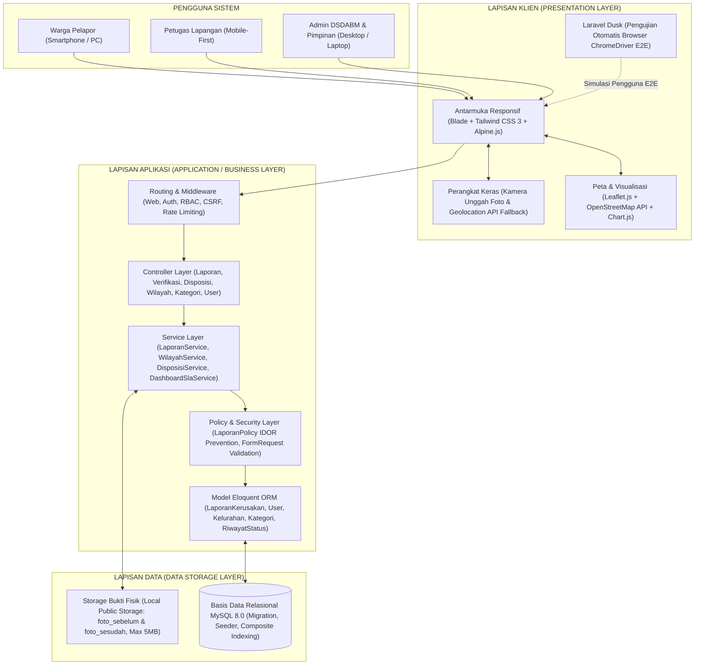

# PPL KELOMPOK BB — INFRA-DAYA
## Laporan Progres Sprint 1 (Minggu 6–10)
### Sistem Informasi Pengelolaan dan Penanganan Kerusakan Infrastruktur Publik (SDG 9) — DSDABM Kota Bandung

---

## 👥 Profil Tim Pengembang (Kelompok BB - SI4802)
- **Rakean Ahmad Zayyid Ardhi** — Full-stack Developer (Master Data Wilayah & Hierarki Geografis)
- **Muhammad Daffa Fachrurozi** — Full-stack Developer (Autentikasi & Manajemen Akun RBAC)
- **Maurellio Christopher Yonathan** (102022430009) — Full-stack Developer & Geotagging Lead (Form Pelaporan, Leaflet.js Geotagging, & Ubah/Batal Tiket)
- **I Nyoman Aditya Wahyu Nughraha** — Full-stack Developer (Master Kategori Infrastruktur & Bobot Prioritas)
- **Wahyu Wijaya** — Full-stack Developer & QA Lead (Verifikasi & Penilaian Prioritas Admin)
- **Muhammad Daffa Reifansya** — Full-stack Developer (Disposisi Digital & Penugasan Lapangan)
- **Baso Aditya Riski** — Full-stack Developer (Dokumentasi SPT Resmi & Integrasi Sistem)

---

## 📊 SLIDE 1 — Ringkasan Eksekutif Sprint 1

```
+----------------------------------------------------------------------------------------------------+
|                                    RINGKASAN EKSEKUTIF SPRINT 1                                    |
+--------------------------+--------------------------+-----------------------+----------------------+
|          18              |          72 SP           |        5 MINGGU       |       7 ANGGOTA      |
| Product Backlog Items    |    Total Story Points    | Waktu Pengerjaan (6-10|  Tim Pengembang PPL  |
+--------------------------+--------------------------+-----------------------+----------------------+
```

### 🎯 Target Inkremen 1
> **Membangun fondasi sistem yang andal, pengelolaan data master wilayah & kategori, alur pelaporan kerusakan infrastruktur warga berbasis geospasial presisi (Leaflet.js), serta alur verifikasi dan disposisi penugasan digital yang dapat didemonstrasikan secara end-to-end pada Sprint Review (Minggu 10).**

### 🌐 Konteks Produk
Aplikasi web responsif berbasis **Laravel 11 MVC** yang mengintegrasikan pelaporan kerusakan sipil (Jalan/Trotoar, Drainase/Gorong-gorong, PJU, dan Jembatan/Tanggul) di 30 Kecamatan dan 151 Kelurahan Kota Bandung secara transparan, akuntabel, dan bebas ketergantungan GPS fisik *real-time*.

### 👤 4 Peran Aktor Utama
1. **Warga (Pelapor)**: Membuat laporan kerusakan, menandai titik koordinat presisi via *draggable marker*, mengunggah bukti foto, memantau riwayat tiket, serta dapat mengubah/membatalkan laporan sebelum diverifikasi.
2. **Admin DSDABM (Verifikator & Dispatcher)**: Memverifikasi keabsahan laporan warga, menetapkan skala prioritas (*Rendah, Sedang, Tinggi*), menolak laporan tidak valid disertai alasan, dan menerbitkan Surat Perintah Tugas (SPT) digital.
3. **Petugas Lapangan (Eksekutor)**: Menerima disposisi penugasan kerja teknis, bernavigasi ke titik koordinat kerusakan via Google Maps/Waze, dan mendokumentasikan hasil perbaikan.
4. **Pimpinan / Wali Kota (Evaluator)**: Memantau indikator kinerja utama (*Service Level Agreement* / SLA), waktu tanggap respon dinas, serta peta sebaran kerusakan se-Kota Bandung.

---

## 🏗️ SLIDE 2 — Arsitektur Sistem & Tumpukan Teknologi

Arsitektur aplikasi dibangun di atas pola **Model-View-Controller (MVC)** berlapis yang aman, terisolasi, dan mudah diuji secara otomatis:



### Tumpukan Teknologi Utama
- **Backend**: Laravel 11.x (PHP 8.2+)
- **Frontend**: Blade Templating, Tailwind CSS 3.x, Alpine.js
- **Peta & Geospasial**: Leaflet.js v1.9.4 & OpenStreetMap Tiles
- **Basis Data**: MySQL 8.0 (InnoDb, Foreign Key Strict Cascade)
- **Ekspor Dokumen**: `barryvdh/laravel-dompdf` (SPT PDF) & `maatwebsite/excel`
- **Testing**: PHPUnit 10.x & Laravel Dusk (Chromium Headless)

---

## 🎯 SLIDE 3 — Cakupan Sprint 1 (Sprint Backlog)

> **SPRINT GOAL:**
> *Membangun fondasi arsitektur sistem, pengelolaan data master wilayah dan kategori, autentikasi multi-peran, alur pelaporan kerusakan infrastruktur oleh warga dengan geotagging interaktif, serta alur verifikasi aduan dan disposisi digital admin yang teruji 100% secara otomatis.*

```
+----------------------------------------------------------------------------------------------------+
|                                    TOTAL CAKUPAN: 72 STORY POINTS                                  |
+------------------------------------+---------------------------------------------------------------+
| KELOMPOK FITUR                     | RINCIAN ITEM PBI & TARGET PENGERJAAN                          |
+------------------------------------+---------------------------------------------------------------+
| 1. Fondasi & Master Wilayah (20 SP)| PBI-01: Setup Proyek, Blade Layout, Migration, & Dusk (8 SP)  |
|                                    | PBI-02: Master Data Kecamatan & Kelurahan 151 Wilayah (7 SP)  |
|                                    | PBI-03: API Chained Dropdown Wilayah Hierarkis (5 SP)         |
+------------------------------------+---------------------------------------------------------------+
| 2. Akun & Otorisasi RBAC (16 SP)   | PBI-04: Registrasi Mandiri Warga & Enkripsi Bcrypt (5 SP)     |
|                                    | PBI-05: Otentikasi Login, Logout, & Session Security (3 SP)   |
|                                    | PBI-06: Manajemen Pengguna & Multi-Role Middleware (8 SP)     |
+------------------------------------+---------------------------------------------------------------+
| 3. Pelaporan Geospasial (21 SP)    | PBI-07: Formulir Pengajuan & Validasi Foto Bukti <= 5MB (8 SP)|
|                                    | PBI-08: Geotagging Peta Leaflet.js & Draggable Pin (8 SP)     |
|                                    | PBI-09: Fitur Ubah & Batal Laporan Sebelum Diverifikasi (5 SP)|
+------------------------------------+---------------------------------------------------------------+
| 4. Master Kategori & Bobot (15 SP) | PBI-10: Master Kategori Infrastruktur 4 Sektor Utama (5 SP)   |
|                                    | PBI-11: Konfigurasi Bobot & Tingkat Prioritas Default (5 SP)  |
|                                    | PBI-12: Filter Data Laporan Berdasarkan Kategori (5 SP)       |
+------------------------------------+---------------------------------------------------------------+
```

---

## 📅 SLIDE 4 — Jadwal Pelaksanaan PBI per Minggu

```
+-------------+---------------------+---------------------+---------------------+---------------------+
| MINGGU 6    | MINGGU 7            | MINGGU 8            | MINGGU 9            | MINGGU 10           |
| (Planning)  | (Data & Wilayah)    | (Form & Geotagging) | (Verifikasi & Alur) | (Review & Retro)    |
+-------------+---------------------+---------------------+---------------------+---------------------+
| PBI-01 (Setup, Migration, Dusk)    |                     |                     |                     |
| PBI-04 (Registrasi Warga)          |                     |                     |                     |
+-------------+---------------------+---------------------+---------------------+---------------------+
|             | PBI-02 (CRUD Wilayah Kecamatan & Kelurahan)                       |                     |
|             | PBI-03 (Chained Dropdown API)                                     |                     |
|             | PBI-05 (Login & Auth Guard)                                       |                     |
|             | PBI-10 (Master Kategori Infrastruktur)                            |                     |
+-------------+---------------------+---------------------+---------------------+---------------------+
|                                   | PBI-06 (Manajemen User & RBAC)              |                     |
|                                   | PBI-07 (Form Laporan & Upload Foto Bukti)   |                     |
|                                   | PBI-08 (Pinpoint Leaflet.js Geotagging)     |                     |
|                                   | PBI-11 (Bobot Prioritas Kategori)           |                     |
+-----------------------------------+---------------------+---------------------+---------------------+
|                                                         | PBI-09 (Ubah/Batal Tiket Laporan)         |
|                                                         | PBI-12 (Filter Kategori Laporan)          |
|                                                         | Audit Keamanan XSS & IDOR                 |
+---------------------------------------------------------+---------------------+---------------------+
|                                                                               | Pengujian Dusk E2E  |
|                                                                               | Pengujian PHPUnit   |
|                                                                               | Demo Sprint Review  |
|                                                                               | Retrospective 1     |
+-------------------------------------------------------------------------------+---------------------+
```

---

## 📋 SLIDE 5 — Kegiatan dan Keluaran Mingguan

| Minggu | Kegiatan Pelaksanaan | Keluaran Faktual (*Deliverables*) |
| :---: | :--- | :--- |
| **Minggu 6** | • Sprint Planning 1 & dekomposisi Product Backlog.<br>• Inisialisasi Git repository & arsitektur proyek Laravel 11.<br>• Konfigurasi Tailwind Tokens (`#1F3A5F`, `#0E7C86`, `#F2A93B`, `#EEF3F6`).<br>• Setup environment pengujian terpisah `.env.dusk.local`. | Repositori aktif, pipeline CI, fondasi layout Blade (`x-admin-layout` & `x-warga-layout`), database dev & dusk terinisialisasi. |
| **Minggu 7** | • Implementasi migrasi dan seeder 30 Kecamatan & 151 Kelurahan.<br>• Pembuatan API endpoint dropdown hierarkis wilayah.<br>• Implementasi sistem autentikasi Breeze & role-based middleware.<br>• Setup master kategori infrastruktur (Jalan, Drainase, PJU, Jembatan). | Modul Master Wilayah berjalan, chained dropdown responsif, login/register multi-role aktif, master kategori tersimpan. |
| **Minggu 8** | • Pengerjaan formulir pelaporan kerusakan warga (PBI-7).<br>• Integrasi peta interaktif Leaflet.js + OpenStreetMap API (PBI-8).<br>• Implementasi draggable marker bebas ketergantungan GPS fisik.<br>• Validasi berkas foto (JPG/PNG <= 5MB) dan pembatasan bounding box Kota Bandung. | Warga dapat menginput aduan dengan koordinat presisi desimal `(10,8)` & `(11,8)`, nomor tiket otomatis `INFRA-YYYYMMDD-XXXX`. |
| **Minggu 9** | • Pengerjaan fitur Ubah dan Batalkan Laporan (PBI-9).<br>• Penerapan modal konfirmasi pembatalan dan isian alasan pembatalan.<br>• Penguncian form (*Read-Only*) jika status aduan telah diproses admin.<br>• Hardening keamanan: pencegahan IDOR via `LaporanPolicy`, CSRF, dan sanitasi XSS. | Warga memiliki kontrol penuh atas aduannya selama status `menunggu_verifikasi`, proteksi akses antar-pengguna terjamin 100%. |
| **Minggu 10** | • Eksekusi pengujian otomatis regresi menyeluruh (Laravel Dusk & PHPUnit).<br>• Penyesuaian antarmuka mobile-first (NFR-03) dan optimasi render peta < 2 detik (NFR-01).<br>• Pelaksanaan demo Sprint Review di hadapan dosen pembimbing.<br>• Sprint Retrospective 1 untuk evaluasi teknis tim. | Seluruh 18 PBI lolos kriteria penerimaan, **140 PHPUnit test PASS**, **48+ Dusk test PASS**, Inkremen 1 siap rilis. |

---

## 👥 SLIDE 6 — Pembagian Tugas Tim & Kepemilikan PBI

```
+----------------------------------------------------------------------------------------------------+
|                                    MATRIKS PENUGASAN ANGGOTA TIM                                   |
+----+--------------------------------+----------------------------+-----------------------+---------+
| NO | NAMA ANGGOTA TIM               | PERAN / ROLE SPESIFIK      | PBI YANG DIKERJAKAN   | POIN SP |
+----+--------------------------------+----------------------------+-----------------------+---------+
| 1  | Rakean Ahmad Zayyid Ardhi      | Backend & Data Wilayah     | PBI-01, PBI-02, PBI-03|  20 SP  |
| 2  | Muhammad Daffa Fachrurozi      | Auth & User Security       | PBI-04, PBI-05, PBI-06|  16 SP  |
| 3  | Maurellio Christopher Yonathan | Geotagging & Form Lead     | PBI-07, PBI-08, PBI-09|  21 SP  |
| 4  | I Nyoman Aditya Wahyu Nughraha | Master Data & Kategori     | PBI-10, PBI-11, PBI-12|  15 SP  |
| 5  | Wahyu Wijaya                   | Verifikasi Admin & QA      | PBI-13, PBI-14, PBI-15|  18 SP  |
| 6  | Muhammad Daffa Reifansya       | Disposisi Penugasan        | PBI-16, PBI-17        |  13 SP  |
| 7  | Baso Aditya Riski              | Integrasi & Dokumen SPT    | PBI-17, PBI-18        |  11 SP  |
+----+--------------------------------+----------------------------+-----------------------+---------+
```

---

## 📜 SLIDE 7 — Definition of Done (DoD) & Ritual Scrum

### ✅ Definition of Done (DoD) Sprint 1
Suatu Product Backlog Item (PBI) dinyatakan **SELESAI (DONE)** jika telah memenuhi 4 kriteria baku:
1. **Pull Request & Code Review**: Kode program disimpan pada branch fitur, digabungkan (*merge*) ke branch utama via Pull Request yang telah ditinjau dan disetujui minimal 1 anggota tim lain.
2. **Kriteria Penerimaan (Acceptance Criteria) Terpenuhi**: Seluruh kebutuhan fungsional (SKF-01 s/d SKF-05) dan non-fungsional (NFR-01 s/d NFR-04) berjalan sesuai spesifikasi PRD.
3. **Pengujian Otomatis 100% Lulus**: Lolos pengujian unit/feature PHPUnit backend dan pengujian simulasi peramban end-to-end Laravel Dusk tanpa kegagalan (*0 failed*).
4. **Demonstrable Feature**: Fungsionalitas fitur dapat dijalankan dan didemonstrasikan secara langsung di hadapan dosen penilai saat sesi Sprint Review.

### 🔄 Ritual Scrum Sprint 1
- **Sprint Planning 1 (Minggu 6)**: Penentuan Sprint Goal, penaksiran estimasi *Story Points* dengan Planning Poker, dan alokasi PBI ke Sprint Backlog.
- **Daily Scrum (Harian / Tiap Pekan)**: Evaluasi 15 menit membahas apa yang telah diselesaikan, rencana berikutnya, dan mitigasi hambatan teknis (*blockers*).
- **Sprint Review & Retrospective 1 (Minggu 10)**: Demonstrasi produk inkremen 1 kepada dosen pembimbing serta evaluasi *What went well*, *What could be improved*, dan *Action items* untuk Sprint 2.

---

## 📱 SLIDE 8 & 9 — Showcase Antarmuka Aplikasi (Inkremen 1)

### A. Portal Pengguna Warga (Citizen Interface)
1. **Autentikasi & Registrasi Warga (PBI-04 / PBI-05)**:
   - Formulir pendaftaran akun warga dengan validasi nama, email, nomor ponsel, dan kata sandi terenkripsi Bcrypt.
2. **Formulir Pengajuan Laporan & Unggah Bukti Fisik (PBI-07)**:
   - Input judul laporan, pilihan kategori aktif berbobot prioritas, deskripsi detail kondisi kerusakan, dan unggahan foto fisik (maksimal 5 MB, sanitasi MIME otomatis).
3. **Pinpoint Lokasi Peta Interaktif Leaflet.js (PBI-08)**:
   - Penanda lokasi (*draggable pin*) yang dapat digeser leluasa di atas peta Kota Bandung tanpa tergantung sinyal GPS perangkat (SKF-03).
   - Tombol bantuan opsional *"Gunakan lokasi saya"* (HTML5 Geolocation), koordinat terkunci *readonly* (`latitude` & `longitude`), dan tombol konfirmasi titik lokasi.
4. **Riwayat Aduan Saya & Fitur Ubah/Batal Laporan (PBI-09)**:
   - Tabel/kartu daftar tiket aduan warga (`INFRA-YYYYMMDD-XXXX`) dengan filter status.
   - Tombol *"Ubah Laporan"* dan *"Batalkan Laporan"* aktif selama berstatus `menunggu_verifikasi`.
   - Modal konfirmasi pembatalan dengan isian wajib alasan pembatalan.
   - Penguncian form otomatis (*Read-Only mode*) saat laporan telah diproses oleh admin.

### B. Portal Administrasi DSDABM & Petugas
1. **Antrean Verifikasi Aduan Masuk (PBI-13 / PBI-14)**:
   - Antarmuka verifikasi aduan dilengkapi filter multi-parameter (status, kategori, kecamatan) serta aksi Setujui (+ pembobotan prioritas) atau Tolak (+ input alasan).
2. **Disposisi Surat Perintah Tugas / SPT (PBI-16 / PBI-17)**:
   - Penerbitan surat tugas digital dan unduhan dokumen resmi format PDF ber-kop Pemkot Bandung via DomPDF.
3. **Master Data Wilayah & Kategori (PBI-02 / PBI-10)**:
   - Manajemen 30 Kecamatan, 151 Kelurahan, dan Kategori Fasilitas Publik.

---

## 🔮 SLIDE 10 — Rencana Berikutnya: Sprint 2 (Minggu 11–15)

Pada Sprint 2, pengembangan dilanjutkan untuk menyelesaikan alur penanganan komprehensif, transparansi publik, dan analitik eksekutif:

```
+----------------------------------------------------------------------------------------------------+
|                                      ROADMAP SPRINT 2 (MINGGU 11-15)                               |
+--------------------------+-------------------------------------------------------------------------+
| MODUL PENGEMBANGAN       | DESKRIPSI FITUR SPRINT 2                                                |
+--------------------------+-------------------------------------------------------------------------+
| 1. Lembar Kerja Petugas  | • Dashboard mobile petugas lapangan (/petugas/tugas)                    |
|    & Penanganan Lapangan | • Navigasi rute instan titik koordinat via Google Maps & Waze           |
|                          | • Unggah dokumentasi foto fisik hasil perbaikan (Before vs After)       |
+--------------------------+-------------------------------------------------------------------------+
| 2. Tracking Publik       | • Lacak progres penanganan publik tanpa login via /lacak-tiket/{tiket}  |
|    & Peta Sebaran Kota   | • Peta sebaran se-Kota Bandung (/peta-publik) dengan filter interaktif  |
|                          | • Linimasa jejak audit status penanganan secara kronologis              |
+--------------------------+-------------------------------------------------------------------------+
| 3. Umpan Balik Warga     | • Penilaian rating kepuasan pelapor (1-5 bintang & ulasan teks)         |
|                          | • Tampilan rating kepuasan terintegrasi pada pelacakan publik           |
+--------------------------+-------------------------------------------------------------------------+
| 4. Dashboard Eksekutif   | • Dashboard monitoring kepatuhan Service Level Agreement (SLA)          |
|    & Analitik SLA        | • 4 Grafik visualisasi Chart.js (Tren aduan, kategori, beban wilayah)   |
|                          | • Rekapitulasi laporan & ekspor resmi format Microsoft Excel & PDF      |
+--------------------------+-------------------------------------------------------------------------+
| 5. Fitur Cerdas          | • Algoritma deteksi potensi laporan duplikat berbasis radius lokasi     |
|    & Kolaborasi          | • Fitur dukungan warga sekitar (Upvote laporan darurat)                 |
+--------------------------+-------------------------------------------------------------------------+
```

---

## 🙏 SLIDE 11 — Penutup, Sesi Tanya Jawab & Diskusi

```
+----------------------------------------------------------------------------------------------------+
|                                            TERIMA KASIH                                            |
|                                                                                                    |
|                     Sistem Informasi INFRA-DAYA — DSDABM Pemerintah Kota Bandung                   |
|                        "Mewujudkan Infrastruktur Kota Bandung yang Andal & Tangguh"                |
|                                                                                                    |
|                                     SESI TANYA JAWAB & MASUKAN                                     |
+----------------------------------------------------------------------------------------------------+
```

